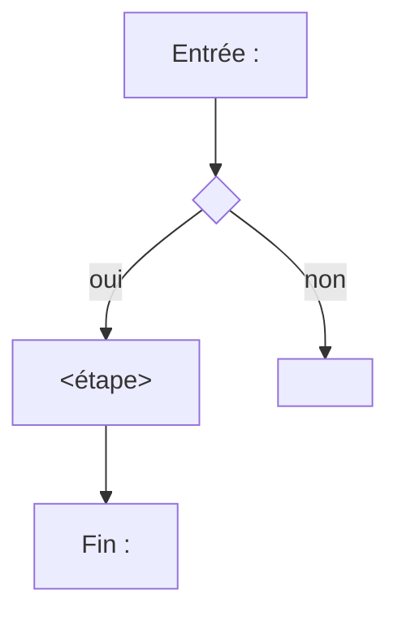
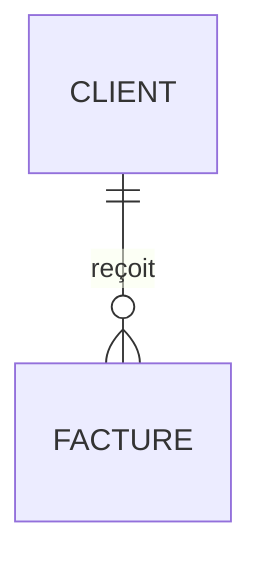
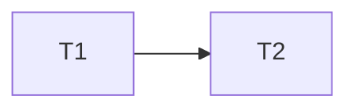
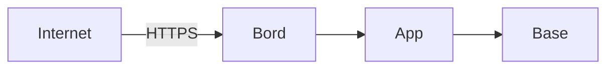

# Templates — one per document

Read only the template of the document being written. Each one gives:

- **Sources**: where Phase 1 looks first, beyond the general table of SKILL.md.
- **Ask**: the questions Phase 2 starts from when the sources are silent,
  with their usual options (recommended first).
- The skeleton, in French. `<…>` is filled; a section marked *(facultatif)*
  is dropped when empty; every other section stays, with an
  `À confirmer :` line when nothing fills it.

Every document opens with the same header and closes with **Sources**:

~~~markdown
# <Nom du document> — <projet>

> Rédigé le <AAAA-MM-JJ> par /docs (mode <both|context|ask>). À confirmer : <n>.

…

## Sources

- [<fichier>:<ligne>](<fichier>#L<ligne>) — <ce qui y a été lu>
~~~

---

## prd — Exigences produit

**Sources**: README, `CLAUDE.md`, `docs/vision*`, routes and CLI commands
(one function each), tests' names, issues cited in `git log`.
**Ask**: who uses it (*un seul rôle* · *public et équipe* · *plusieurs rôles
métier*); what is out of scope; how success is measured.

~~~markdown
## En une phrase
<ce que fait le produit, pour qui, pourquoi maintenant>

## Utilisateurs
| Rôle | Ce qu'il veut | Ce qu'il ne doit pas pouvoir faire |
|------|---------------|------------------------------------|

## Fonctions
### F1 — <nom>
- **Pour** : <rôle>
- **Besoin** : <le problème, pas la solution>
- **Comportement** : <ce que voit et fait l'utilisateur>
- **Règles** : <limites, cas refusés>
- **Fait quand** : <critère vérifiable>
- **État** : existant [source] · prévu · à confirmer

(une sous-section par fonction, numérotées F1, F2…)

## Hors périmètre
- <ce que le produit ne fera pas, et pourquoi>

## Mesure du succès
| Indicateur | Cible | Comment on le mesure |
|------------|-------|----------------------|

## Questions ouvertes (facultatif)
~~~

---

## trd — Exigences techniques

**Sources**: `go.mod`, `package.json`, `pyproject.toml`, `Cargo.toml`,
Dockerfiles, IaC (`*.tf`, Ansible, Nomad), CI workflows, `CLAUDE.md` ledger.
**Ask**: hosting target; supported runtimes and versions; external services
allowed.

~~~markdown
## Pile
| Couche | Choix | Version | Pourquoi (ADR ou source) |
|--------|-------|---------|--------------------------|

## Exécution
- **Où** : <hôte, région, orchestrateur>
- **Comment** : <binaire, conteneur, fonction>
- **Configuration** : <variables, fichiers, secrets et leur magasin>

## Dépendances externes
| Service | Usage | Si indisponible |
|---------|-------|-----------------|

## Contraintes
- <MUST / MUST NOT, chacune avec sa source ou sa contrainte C-NNN>

## Limites connues (facultatif)
~~~

---

## flow — Parcours

**Sources**: routers, handlers, page templates, redirects, middleware
(auth), e2e tests (they are journeys already written).
**Ask**: entry points; what happens on each error.

~~~markdown
## Parcours
### P1 — <nom> (<rôle>)
<but du parcours en une phrase>



| Étape | Écran ou appel | Données lues ou écrites | Source |
|-------|----------------|-------------------------|--------|

**Erreurs** : <chaque branche d'échec et ce que voit l'utilisateur>

(un parcours par fonction de `prd` qui a une interface)

## Navigation d'ensemble (facultatif)
```mermaid
flowchart LR
  <écrans et leurs liens>
```
~~~

---

## design — Brief de design

**Sources**: stylesheets and their variables, component directories,
templates, any design tokens file, screenshots under `docs/`.
**Ask**: tone (*sobre* · *chaleureux* · *technique*); references to follow
or avoid; accessibility target (*WCAG 2.2 AA (recommandé)* · *AAA* · *aucune*).

~~~markdown
## Intention
<l'impression à donner, en trois mots et une phrase>

## Couleurs et typographie
| Jeton | Valeur | Usage | Source |
|-------|--------|-------|--------|

## Composants
| Composant | Où | États (normal, survol, désactivé, erreur) |
|-----------|----|-------------------------------------------|

## Mise en page
- <grille, largeurs, points de rupture, mobile d'abord ou non>

## Accessibilité
- <cible, contrastes, clavier, lecteurs d'écran>

## À éviter
- <ce qui ne doit jamais apparaître>
~~~

---

## data — Schéma de données

**Sources**: migrations in order, `*.sql`, ORM models, schema files,
retention jobs, backup scripts, access checks in handlers.
**Ask**: retention per entity; who may read personal fields.

~~~markdown
## Entités


### <Entité>
| Champ | Type | Obligatoire | Personnel | Note |
|-------|------|-------------|-----------|------|

- **Créée par** : <fonction F-n ou processus>
- **Durée de vie** : <durée, puis suppression ou anonymisation>

(une sous-section par entité)

## Qui voit quoi
| Entité ou champ | Visiteur | Client (le sien) | Équipe | Admin | Système |
|-----------------|----------|------------------|--------|-------|---------|
| <…> | — | lecture | lecture | lecture, écriture | écriture |

## Stockage et copies
- **Où** : <base, fichier, bucket>
- **Sauvegarde** : <fréquence, rétention, lieu>
- **Migrations** : <outil, sens unique ou réversibles>
~~~

---

## impl — Plan d'implémentation

**Sources**: every other document written or present, open issues, TODOs in
the code (`git grep -n TODO`), the plans under `.claude/plans/`.
**Ask**: the first deliverable (*le plus petit utilisable (recommandé)* ·
*la fonction la plus risquée d'abord* · *l'infrastructure d'abord*);
deadlines.

~~~markdown
## Jalons
| Jalon | Contient | Livré quand |
|-------|----------|-------------|

## Tâches
| Id | Tâche (30 caractères au plus) | Dépend de | Fait quand | Réf. |
|----|-------------------------------|-----------|------------|------|
| T1 | <verbe à l'infinitif + objet> | — | <critère vérifiable> | F1 |
| T2 | <…> | T1 | <…> | data |

## Ordre


## Risques
| Risque | Tâche | Parade |
|--------|-------|--------|
~~~

Every `Dépend de` names ids of this table only; no cycle. These are the
dependencies Phase 5 turns into `blocked_by`.

---

## adr — Décisions (ADR)

**Sources**: `git log` bodies that explain a choice, `CLAUDE.md` decisions
with a date, comments that say "we chose X because".
**Ask**: for each candidate decision, *Consigner (recommandé)* · *Pas une
décision d'architecture*.

One file per decision, `docs/adr/NNNN-<slug>.md`, numbered after the last:

~~~markdown
# NNNN — <décision au présent>

- **Statut** : accepté · proposé · remplacé par NNNN
- **Date** : <date de la décision, celle de la source>

## Contexte
<la contrainte ou le problème, avec ses sources>

## Décision
<ce qui est choisi, en une phrase active>

## Options écartées
| Option | Pourquoi non |
|--------|--------------|

## Conséquences
- <ce qui devient facile, ce qui devient difficile>
~~~

---

## voice — Ton et règles d'écriture

**Sources**: public templates and pages, i18n files, emails sent by the code,
README tone, existing style notes in `CLAUDE.md`.
**Ask**: tutoiement or vouvoiement; forbidden punctuation or words;
languages.

~~~markdown
## Le ton
<trois adjectifs, et ce que chacun exclut>

## Adresse
- <tu ou vous, et dans quels cas>

## Règles
| Règle | Exemple juste | Exemple faux |
|-------|---------------|--------------|

## Mots
| Dire | Ne pas dire | Pourquoi |
|------|-------------|----------|

## Messages types (facultatif)
- **Erreur** : <modèle>
- **Confirmation** : <modèle>
~~~

---

## glossary — Glossaire

**Sources**: type and table names, UI labels, `prd` functions, words the
code and the interface spell differently.
**Ask**: for each pair of competing terms, which one wins.

~~~markdown
| Terme | Définition | Dans le code | Dans l'interface | À ne pas confondre avec |
|-------|------------|--------------|------------------|-------------------------|
~~~

Alphabetical. One line per notion; a synonym points to its term.

---

## quality — Qualité attendue

**Sources**: CI thresholds, linters' configuration, coverage settings,
performance tests, uptime probes, SLAs mentioned anywhere.
**Ask**: availability target (*99,9 % (recommandé)* · *99 %* · *aucun*);
latency budget; accessibility.

~~~markdown
| Dimension | Seuil | Mesuré par | Bloque la fusion | Source |
|-----------|-------|------------|------------------|--------|
| Disponibilité | | | | |
| Latence (p95) | | | | |
| Couverture de tests | | | | |
| Accessibilité | | | | |
| Lint | | | | |
| Taille ou poids | | | | |

## Hors seuil (facultatif)
- <ce qu'on surveille sans bloquer>
~~~

---

## testing — Stratégie de test

**Sources**: `*_test.*`, `tests/`, `e2e/`, CI jobs, Makefile targets, test
doubles and fixtures.
**Ask**: what must never ship untested; where e2e tests run.

~~~markdown
## Niveaux
| Niveau | Outil | Ce qu'il couvre | Où il tourne | Commande |
|--------|-------|-----------------|--------------|----------|
| Unitaire | | | | |
| Intégration | | | | |
| Bout en bout | | | | |

## Ce qui bloque une fusion
- <job CI et seuil>

## Données de test
- <doublures, jeux de données, ce qui n'est jamais réel>

## Trous connus
- <ce qui n'est pas testé, et pourquoi>
~~~

---

## threat — Modèle de menaces

**Sources**: auth and session code, crypto calls, secret handling, firewall
rules (nftables, security groups), exposed ports, `data`'s "qui voit quoi".
**Ask**: the attacker that matters most (*internet anonyme (recommandé)* ·
*client authentifié malveillant* · *accès interne*); what loss is worst.

~~~markdown
## Ce qu'on protège
| Bien | Pourquoi il compte | Où il vit |
|------|--------------------|-----------|

## Frontières de confiance


## Menaces (STRIDE)
| Id | Menace | Catégorie | Point d'entrée | Parade en place [source] | Reste à faire |
|----|--------|-----------|----------------|--------------------------|---------------|

## Risques acceptés
| Risque | Pourquoi accepté | Par qui, quand |
|--------|------------------|----------------|
~~~

---

## rgpd — Registre RGPD

**Sources**: `data` (personal fields), forms, emails, logs that hold IPs,
third parties receiving data (mail, analytics, payment), retention jobs.
**Ask**: the controller's identity; legal basis per processing.

~~~markdown
## Responsable du traitement
<nom, contact, DPO s'il y en a un>

## Traitements
### T1 — <finalité>
| | |
|---|---|
| Personnes concernées | |
| Données | <champs, renvoi à data> |
| Base légale | contrat · obligation légale · intérêt légitime · consentement |
| Destinataires | <internes, sous-traitants> |
| Transferts hors UE | |
| Durée de conservation | <durée, et le code qui l'applique> |
| Sécurité | <chiffrement, accès, renvoi à threat> |

(un traitement par finalité)

## Droits des personnes
- <comment exercer accès, rectification, effacement, et le délai>
~~~

---

## ops — PRA et runbooks

**Sources**: IaC, Ansible playbooks, Nomad jobs, systemd units, backup
scripts, Makefile targets, monitoring and alert configuration.
**Ask**: RPO and RTO per service; who is called.

`docs/ops/README.md`, the index:

~~~markdown
## Services
| Service | Où | RPO | RTO | Sauvegarde | Runbook |
|---------|----|-----|-----|------------|---------|

## Scénarios
| Scénario | Premier geste | Runbook |
|----------|---------------|---------|
~~~

One runbook per procedure, `docs/ops/<slug>.md`:

~~~markdown
# <Procédure>

- **Quand** : <symptôme ou décision qui la déclenche>
- **Durée** : <estimée>
- **Prérequis** : <accès, secrets et leur magasin, outils>

## Étapes
1. <commande exacte> — **attendu** : <sortie>

## Vérifier
- <commande et résultat qui prouvent le retour à la normale>

## Retour arrière
1. <…>
~~~

---

## readme — README et démarrage

**Sources**: manifests, Makefile, scripts, `CLAUDE.md`, `.env.example`, CI.
**Ask**: the audience (*contributeurs (recommandé)* · *utilisateurs* · *les
deux*).

~~~markdown
# <projet>

<ce que c'est, en deux phrases>

## Démarrer
```sh
<commandes exactes, de zéro à « ça tourne », vérifiées dans le dépôt>
```

## Commandes utiles
| Commande | Effet |
|----------|-------|

## Structure
<les dossiers qui comptent, une ligne chacun>

## Documents
<liens vers les documents du catalogue présents>
~~~

The README is the one document without the `> Rédigé le …` header and with
its Sources kept out of it: list them in the conversation instead.
